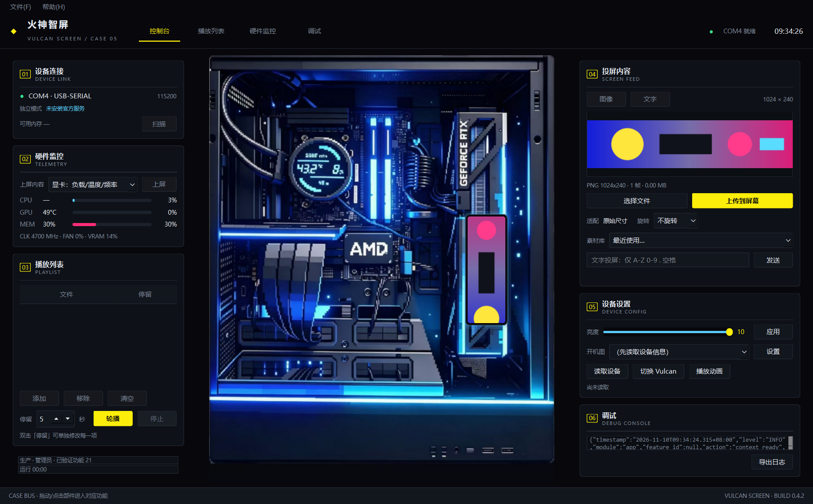

<div align="center">

# 火神智屏图传工具 · Vulcan LCD Uploader

面向 **iGame 火神 RTX 50 系**显卡副屏（LCD5A，1024×240）的开源上传工具

<a href="https://github.com/ChangLe2002/vulcan-lcd-uploader/releases"></a>
<a href="https://github.com/ChangLe2002/vulcan-lcd-uploader/blob/main/LICENSE"></a>
<a href="https://github.com/ChangLe2002/vulcan-lcd-uploader/actions/workflows/tests.yml"></a>


<a href="docs/screenshots/main.png"></a>

</div>

---

用官方 iGame Center 换图只能用它自带的几张素材，而且要一直开着它的服务。
这个工具直接和副屏通信：**任何 GIF / 图片都能传上去**，还能做轮播、把硬件数据交给屏幕显示。
不联网、不上报，也不需要管理员权限。

> 非官方项目，与七彩虹（Colorful）/ iGame 无隶属或授权关系。使用前请阅读 [免责声明](#免责声明)。

## 功能

| 能力 | 说明 |
| --- | --- |
| **图像上传** | GIF / PNG / JPEG → 设备 pak，固定 30fps 播放；与官方相同的编码管线（旋转 180°、1024×240 内边距、JPEG q6） |
| **播放列表轮播** | 每项独立停留秒数，自动上传 → 校验清单 → 循环切换 |
| **硬件监控上屏** | GPU 负载/温度/频率、CPU 负载/频率/内存（轮显），由屏幕自己渲染，不上传图片 |
| **设备设置** | 读取固件/亮度/ID、调整亮度、设置开机图、切换 Vulcan 开机动画 |
| **缓存清理** | 安全模式（只删本工具上传的）/ 彻底模式（回收被无效缓存占用的空间） |
| **素材库** | 最近 30 个素材一键载入 |
| **托盘常驻** | 关闭窗口最小化到托盘，隐藏后 CPU 0%、内存约 20 MB |
| **独立模式** | 完全不依赖 iGame Center 服务 |

## 系统要求

- Windows 10 / 11（64 位）
- iGame 火神 RTX 50 系显卡，副屏可正常显示
- 安装包已内置 Python 运行时与 Qt，无需预装 Python
- FFmpeg **不随包分发**：系统里能找到（iGame Center 自带或 PATH）就用它编码，
  找不到则自动用 Pillow 编码，功能不受影响

## 安装

到 [Releases](https://github.com/ChangLe2002/vulcan-lcd-uploader/releases) 下载，二选一：

| 文件 | 说明 |
| --- | --- |
| `VulcanLCDUploader-<版本>-portable.zip` | **推荐**。解压后双击 `install.cmd`，装到 `%LOCALAPPDATA%\Programs\VulcanLCDUploader`，不需要管理员 |
| `VulcanLCDUploader-Setup-<版本>.exe` | 常规安装包（中文向导）。若系统禁止未签名程序写入 `%TEMP%` 会报 Error 5，请改用上面的 zip |

卸载：**设置 → 应用 → 火神智屏图传工具 → 卸载**，或运行安装目录里的 `uninstall.cmd`。

安装位置、目录结构与手动安装方式见 [docs/INSTALL.md](docs/INSTALL.md)。

## 快速上手

1. 插好显卡、确认副屏正常点亮，打开软件
2. 左侧 **01 设备连接** 显示 `COMx · USB-SERIAL` 即已识别
3. **04 投屏内容** → 选择文件 → 确认预览 → **上传到屏幕**
4. 想做轮播：**03 播放列表** → 添加多张 → 设置停留秒数 → **轮播**
5. 想让屏幕显示硬件数据：**02 硬件监控** → 选择布局 → **上屏**

第一次启动会要求阅读 20 秒免责声明与功能说明，之后可在 **帮助 → 免责声明与使用说明** 重看。

## 界面

| 区域 | 内容 |
| --- | --- |
| 01 设备连接 | 串口、官方服务状态、可用空间（只读展示） |
| 02 硬件监控 | CPU/GPU/内存占用条、上屏布局选择 |
| 03 播放列表 | 轮播队列与每项停留时间 |
| 中间 | 机箱示意图，显卡小屏位置实时预览竖屏画面（可点击放大） |
| 04 投屏内容 | 横屏预览、上传、旋转、素材库、文字投屏 |
| 05 设备设置 | 亮度、开机图、开机动画 |
| 06 调试 | 实时日志与导出 |

## 常见问题

<details>
<summary>上传时报"无法打开 COMx"</summary>

串口是独占的。如果勾选了「独立模式」但 iGame Center 服务仍在运行，先停掉服务
（`sc stop iGameCenterService`）或取消独立模式。详见 [docs/TROUBLESHOOTING.md](docs/TROUBLESHOOTING.md)。
</details>

<details>
<summary>传上去的文件在清单里消失了</summary>

官方服务启动时会移除它不认识的槽位，且不释放空间。用「文件 → 清理设备缓存 → 彻底清理」回收。
</details>

<details>
<summary>设备像"卡住"了，写入有应答但列表不更新</summary>

给屏幕断电 10 秒再上电即可恢复，不需要重装软件。
</details>

<details>
<summary>安装包报 Error 5 / `is-XXXX.tmp` 拒绝访问</summary>

系统禁止未签名程序写 `%TEMP%`。改用 portable.zip 安装方式即可。
</details>

更多见 [docs/TROUBLESHOOTING.md](docs/TROUBLESHOOTING.md)。

## 工作原理

工具通过显卡的 USB 虚拟串口与副屏通信，帧格式为 `5A 9F A9 | 长度 | 命令 | 数据 | 校验和`。
图片会被编码成设备认的 `pak` 容器（4 字节长度 + JPEG 帧序列）。

协议细节、请求/应答样例与验证记录都在 [docs/PROTOCOL.md](docs/PROTOCOL.md)，
每一条都附有抓包或反编译证据；没有证据的字段一律不发送。

## 安全与隐私

- **不联网**：程序不包含任何网络代码，不上报、不检查更新
- **不碰底层**：不读写 VBIOS / SPI Flash / 固件，不提供刷机功能
- **写操作有闸门**：只有登记为「已验证」的功能才能写串口，支持 `--dry-run` 只读模式
- **最小权限**：除「停止/启动官方服务」外不需要管理员；用「独立模式」可完全避开

详见 [SECURITY.md](SECURITY.md) 与 [docs/SECURITY_AND_PERFORMANCE.md](docs/SECURITY_AND_PERFORMANCE.md)。

## 开发与构建

```powershell
python -m pip install -r requirements.txt      # 运行依赖
python -m pip install pytest                   # 测试
python main.py --debug                         # 源码运行
python -m pytest tests -q                      # 450+ 项测试
powershell -ExecutionPolicy Bypass -File .\scripts\build.ps1      # 打包
```

环境搭建、目录结构、打包与发版流程见 [docs/DEVELOPMENT.md](docs/DEVELOPMENT.md)。
项目规划见 [docs/ROADMAP.md](docs/ROADMAP.md)。

## 贡献

欢迎 Issue 与 PR。提交前请阅读 [CONTRIBUTING.md](CONTRIBUTING.md)：
本项目坚持「不猜协议、不碰底层、默认只读」三条底线。

## 许可证与致谢

[MIT License](LICENSE) © 2026 常乐（Changle）

协议事实来自公开的逆向分析文章（CC BY-SA 4.0，仅引用事实性参数，未转载原文）、
开源项目 [wiselike/LCD](https://github.com/wiselike/LCD)（MIT，未复制源码），
以及对官方程序集的反编译查证。完整致谢见 [AUTHORS.md](AUTHORS.md)，
第三方组件许可见 [THIRD_PARTY_NOTICES.md](THIRD_PARTY_NOTICES.md)。

## 免责声明

本软件为第三方非官方工具，按「现状」提供，不提供任何担保。使用本软件可能导致屏幕显示异常、
需要断电重启设备等情况，**风险由使用者自行承担**。请在使用前备份设备上原有的图片与动画，
不要将本软件用于商业分发。完整条款见软件内首次启动窗口与 [LICENSE](LICENSE)。
